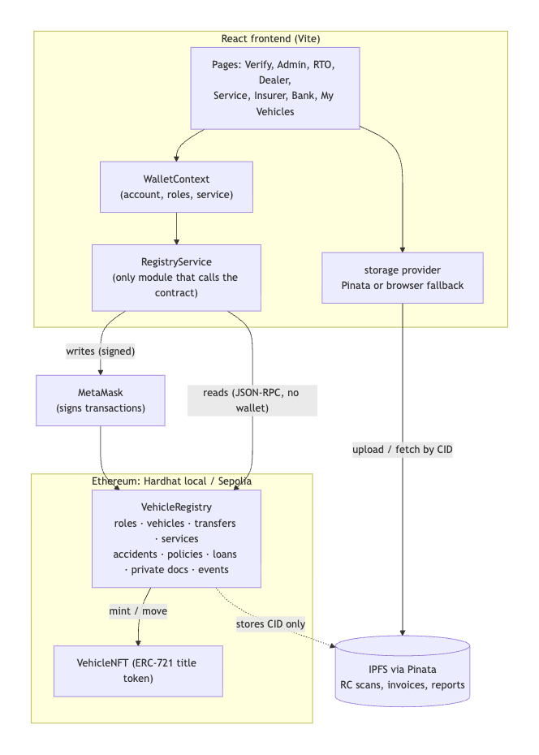
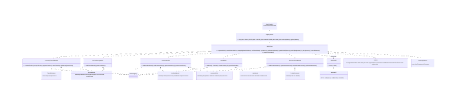
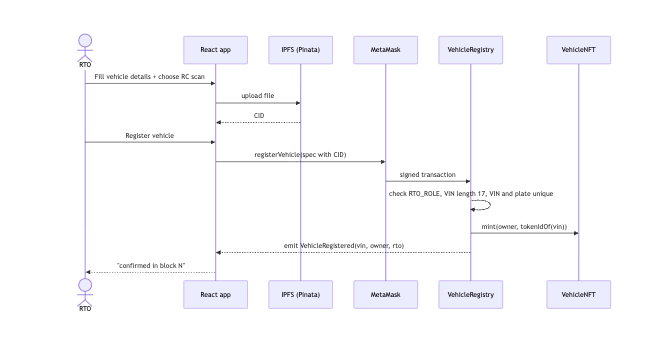
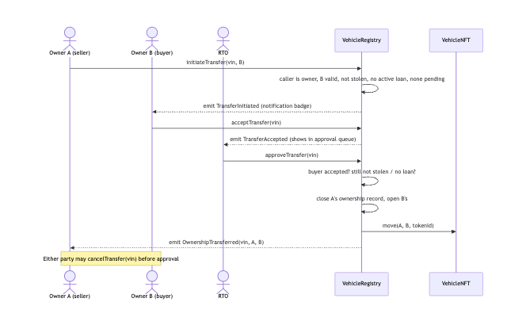
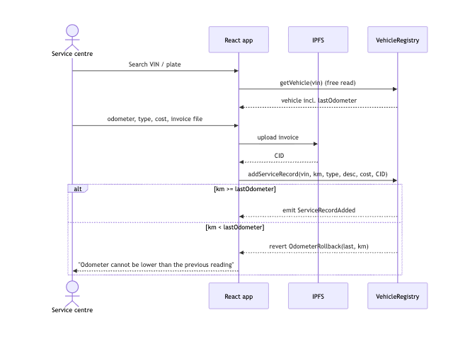
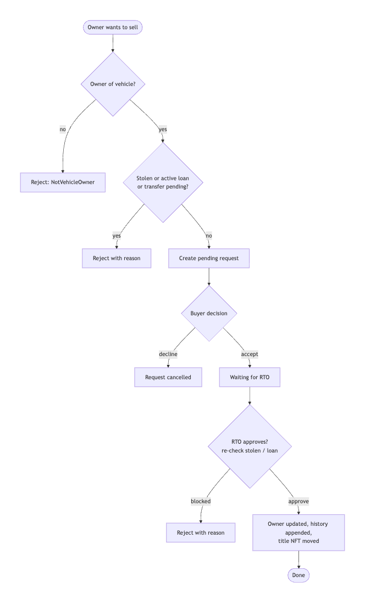
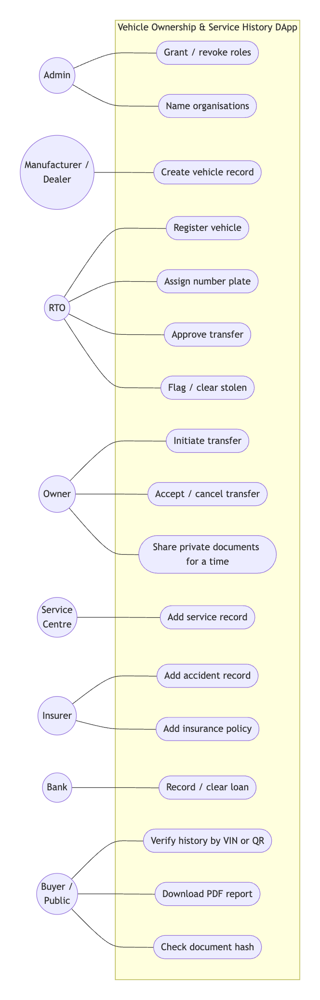
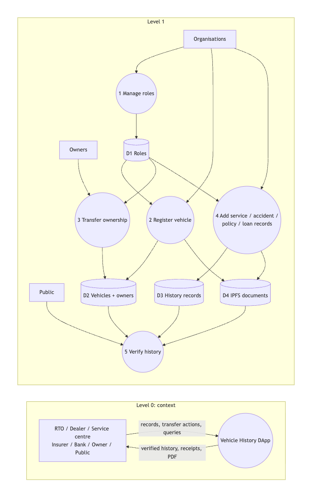

# Design Notes

Material for the report: how the code is organised, how it follows SOLID, the test results and gas costs.
Diagram sources are the `.mmd` files in [diagrams/](diagrams/) (Mermaid; GitHub renders them), with PNG exports beside them.

## Architecture

- **No backend.** The blockchain is the database and IPFS is the file store; the React app talks to both directly.
- **Reads need no wallet.** The app reads through a JSON-RPC provider, so anyone can verify a vehicle. MetaMask is only used to sign transactions.
- **One deployable registry, split into modules.** `VehicleRegistry` composes six abstract modules, so the frontend has one address and one ABI while each concern stays in its own file.
- **Title NFT.** `VehicleNFT` (ERC-721) mirrors ownership. It can only be minted or moved by the registry, so the consent + RTO approval flow cannot be bypassed with a normal NFT transfer.

## SOLID in this codebase

| Principle | Contracts | Frontend |
|---|---|---|
| **Single responsibility** | One module per concern: `RegistryAccess` (roles, names), `VehicleCore` (vehicle + ownership state), `OwnershipTransferModule`, `ServiceHistoryModule`, `InsuranceModule`, `LoanModule`, `DocumentAccessModule`. `VehicleRegistry` only composes them. | `RegistryService` only talks to the contract, `storage` only stores files, `useTransaction` only tracks transactions, `friendlyError` only formats errors, pages only lay out components. |
| **Open / closed** | `_requireTransferable` is `virtual`. `LoanModule` adds the "active loan" rule by overriding and calling `super`, without editing `VehicleCore` or the transfer module. A new rule (e.g. pending fines) would be another override. | Roles are data in `constants/roles.js`; adding a role adds a row, and the navbar, guards and admin panel pick it up. New storage back-ends are new providers. |
| **Liskov substitution** | Any `IVehicleNFT` implementation can be passed to the registry constructor. | `createPinataStorage` and `createBrowserStorage` return the same shape (`upload`, `fetchBytes`, `openUrl`); either can be used anywhere. |
| **Interface segregation** | The registry depends on `IVehicleNFT` (only `mint` and `move`), not the whole ERC-721 surface. Each module exposes only its own functions. | Components receive only what they use (`VehicleForm` gets a `submit` function, not the whole service). |
| **Dependency inversion** | `VehicleCore` holds an `IVehicleNFT`, injected at deploy time. | Pages depend on `useWallet().service` and `storage`, abstractions chosen by configuration, never on ethers contracts, Pinata or IndexedDB directly. |

### No duplicated logic

See [FUNCTIONS.md](FUNCTIONS.md) for the full registry. Examples of shared code:

- Ownership changes only in `_changeOwner`; the odometer check only in `_recordOdometer`.
- RTO registration and dealer creation share `_createVehicle` in the contract and `VehicleForm` in the UI.
- Deploy logic (`deployRegistry`) is shared by the deploy script and the tests.
- The same CID function is used to store files in the no-key mode and to verify files from Pinata.

## Data model

## Flows

| Registration | Transfer | Service record |
|---|---|---|
|  |  |  |

Transfer activity: 

Use cases: 

Data flow (Level 0 and 1): 

## Document integrity

Files are stored on IPFS and only the CID goes on-chain. "Verify hash" downloads the file and recomputes
its CID in the browser with the same settings Kubo/Pinata use (256 KiB chunks, balanced DAG, 174 links;
raw leaves for CIDv1). If one byte changed, the CID would differ and the badge says "does NOT match".

Without a Pinata JWT the app uses a browser store keyed by the same CIDs, so the demo works offline.
Those files exist only in the browser that uploaded them.

## Test results

`npx hardhat test`: **44 passing**. `npx hardhat coverage`: **100% statements, functions and lines; 84.5% branches.**

| # | README test case | Result |
|---|---|---|
| 1 | Deployer has admin role | Pass |
| 2 | Admin grants RTO role, RTO can register | Pass |
| 3 | Non-RTO tries to register | Reverts (AccessControlUnauthorizedAccount) |
| 4 | Register with valid data | Stored, event emitted, history has 1 entry, NFT minted |
| 5 | Duplicate VIN | Reverts (VehicleAlreadyExists) |
| 6 | VIN not 17 characters | Reverts (InvalidVinLength) |
| 7 | Non-owner initiates transfer | Reverts (NotVehicleOwner) |
| 8 | Full transfer | Owner changed, history has 2 entries, NFT moved |
| 9 | RTO approves before buyer accepts | Reverts (BuyerHasNotAccepted) |
| 10 | Transfer while stolen | Reverts (VehicleIsStolen) |
| 11 | Cancel pending transfer | Request cleared |
| 12 | Service centre adds record | Stored, lastOdometer updated |
| 13 | Lower odometer | Reverts (OdometerRollback) |
| 14 | Non-service-centre adds record | Reverts |
| 15 | Insurer adds accident | Stored |
| 16 | Revoked service centre adds record | Reverts |
| 17 | Reads without a wallet | Returns data |

Extra tests cover the manufacturer flow, duplicate plates, approval blocked when a vehicle is flagged or a loan
is added after the request, NFT transfer lock, insurance policies, loans, time-limited document access, and
a check that no edit/delete function exists.

## Gas costs

From `REPORT_GAS=true npx hardhat test` (full table: [gas-report.txt](gas-report.txt)).

| Function | Avg gas |
|---|---|
| registerVehicle | 523,921 |
| manufactureVehicle | 482,969 |
| addServiceRecord | 198,215 |
| addAccidentRecord | 175,658 |
| addInsurancePolicy | 168,056 |
| addLoan | 156,038 |
| addPrivateDocument | 143,476 |
| initiateTransfer | 124,646 |
| grantRole | 117,757 |
| approveTransfer | 207,234 |
| assignRegistrationNumber | 76,102 |
| clearLoan | 53,614 |
| grantDocumentAccess | 52,163 |
| setEntityName | 49,938 |
| cancelTransfer | 40,460 |
| setStolenStatus | 32,407 |
| acceptTransfer | 29,525 |
| Deploy VehicleRegistry | 3,969,422 |
| Deploy VehicleNFT | 1,216,698 |

Registration is the most expensive call because it stores several strings and mints the title NFT.

## Known limitations (for the report)

- Contract storage is public on any blockchain. Private documents are hidden by the app and gated in the contract's view function, but anyone reading raw storage can see their CIDs. Encrypt sensitive files before upload in a real deployment.
- Event logs give each record its transaction hash. Some free RPC providers limit log queries; the app then still shows every record, just without the tx link.
- Owners are pseudonymous wallet addresses; only organisations get display names (no personal data on-chain).
